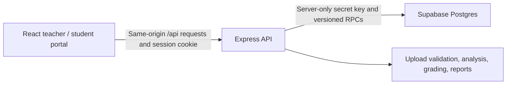

# LabTrack

LabTrack is a Web Engineering classroom application. Teachers publish lab tasks, review submitted websites, compare code, assign marks and export marks sheets. Students sign in with a roll number or email, upload work for each task and see published feedback.

**Start with the [documentation index](docs/README.md).** It includes a reading order for new developers and AI coding tools.

## How it works



The browser communicates through Express. LabTrack implements its own accounts and sessions; it does not use Supabase Auth. Uploaded source, images and instruction attachments live in private database records. Supabase Storage, Realtime and Edge Functions are not part of the current implementation.

The documented production site is [labtrack-lilac.vercel.app](https://labtrack-lilac.vercel.app), hosted on Vercel with Supabase persistence. Local JSON and MongoDB adapters are also available. See [architecture](docs/architecture.md) for the differences between a persistent Node process and the Vercel handler.

## Run locally

Use Node.js 22 or newer; the documented production runtime is Node 24. Install the locked dependencies:

```powershell
npm ci
```

Preserve an existing private `.env`. For an isolated demo, create it from the example only when it does not exist:

```powershell
if (!(Test-Path -LiteralPath .env)) { Copy-Item -LiteralPath .env.example -Destination .env }
npm run dev
```

Open [http://127.0.0.1:5173](http://127.0.0.1:5173). The isolated demo requires hosted database settings to be absent from the environment. It saves to `.data/labtrack.json` and automatically opens the teacher demo. Sample login: `teacher@labtrack.edu`, or student roll `1`, with `LabTrack2026!`. These are public sample credentials, never production credentials.

For the existing hosted classroom, follow [local Supabase setup](docs/supabase-local.md). For a fresh database or other persistence mode, follow [getting started](docs/getting-started.md). Do not point demo mode at a real class database.

```powershell
npm test
npm run build
npm start
```

The build checks TypeScript and creates `dist/`. `npm start` serves that build and the API at [http://127.0.0.1:3001](http://127.0.0.1:3001). The development frontend always proxies `/api` to port 3001; changing `PORT` also requires updating that proxy.

## Documentation

| Guide | What it explains |
| --- | --- |
| [Documentation index](docs/README.md) | Reading order, terminology and verification scope |
| [Getting started](docs/getting-started.md) | Demo, existing classroom, fresh database and provisioning |
| [Architecture](docs/architecture.md) | Repository map, domain model, request flows and invariants |
| [Frontend](docs/frontend.md) | Components, state, styling, preview and change recipes |
| [Backend](docs/backend.md) | Express lifecycle, authorization, validation and persistence |
| [API reference](docs/api.md) | Every route, request/response contracts and errors |
| [Supabase](docs/supabase.md) | Tables, functions, grants, migrations and concurrency |
| [Configuration](docs/configuration.md) | Environment variables and runtime modes |
| [Analysis and uploads](docs/analysis.md) | Parser checks, similarity, extraction and limits |
| [Operations](docs/operations.md) | Tests, troubleshooting, backups and maintenance |
| [Deployment](docs/launch.md) | Vercel configuration and release checks |
| [AI development](docs/ai-development.md) | Context handoff and modification patterns |
| [AGENTS.md](AGENTS.md) | Repository instructions for coding agents |
| [Assignment requirements](docs/lab-requirements.md) | Original assignments and manual review |
| [Free-tier audit](docs/free-tier-audit.md) | Historical measurements from 13 October 2026 |

## Core behavior

- Teachers save draft labs or publish them. Labs have 1–20 tasks with independent instructions, checklists and marks. Task IDs stay stable during edits.
- Students submit files, folders, ZIPs and/or an HTTP(S) link per task. Resubmission replaces the project, increases its revision and clears its grade. Old revisions are not archived.
- Teachers save private draft grades or publish feedback. Grade requests include the reviewed revision; stale grades are rejected.
- Check tasks shows missing work, requirements, quality observations and similarity evidence. Flags require matching coverage strictly over 70% by default, or over 50%, in both comparable projects. Analysis never changes marks and does not detect AI authorship.
- CSV/A4 reports have four columns: R. No, Name, Marks in Figure, Marks in Words. Totals require all task grades, including teacher draft grades. Blank totals and zero marks differ.

The demo roster contains rolls 1–41 from the supplied marks-sheet names. Rolls 16, 26, 27, 30, 34, 37 and 39 have no supplied name. Exam marks from that image were not imported. Demo dates, aliases, submissions and grades are illustrative; real class provisioning imports accounts and two draft labs without demo submissions.

For matching examples, run `npm run build` and `npm run demo:analysis`, then open [http://127.0.0.1:3012](http://127.0.0.1:3012). This uses a separate store and cookie, with hosted access explicitly disabled.

## Current boundaries

This is a single-class app with rolls limited to 1–41. There is no self-registration, password-reset UI, multi-class tenancy, realtime subscription or object-storage integration. Persistent servers use one in-memory working snapshot. Vercel uses request-owned snapshots, revision-checked caching and bounded conflict retries. Submitted code executes only in the restricted browser preview; remote project links are not fetched by the server.

Documentation was reviewed against source and read-only Supabase metadata on **13 October 2026**. Provider quotas and historical hosting observations can change; the guides identify verification limits.
