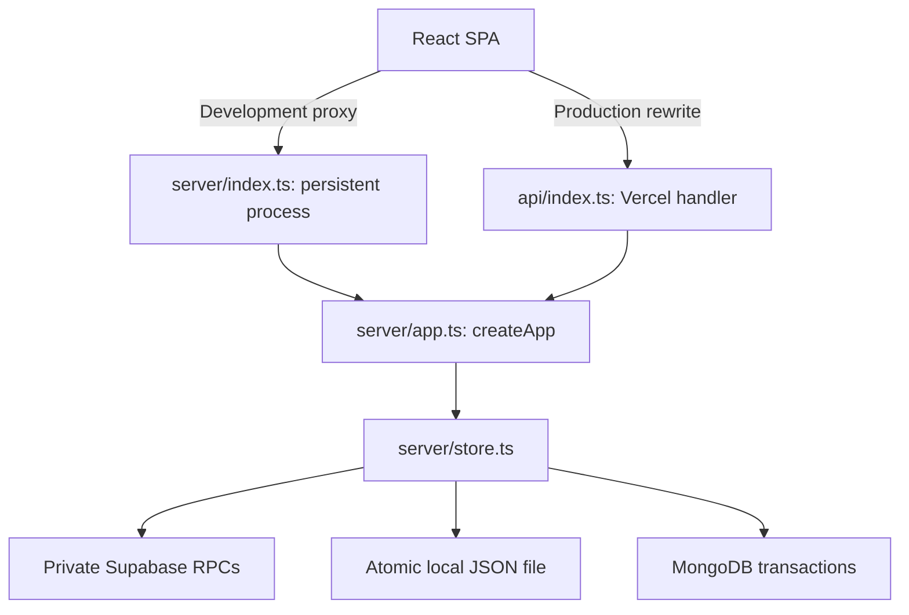
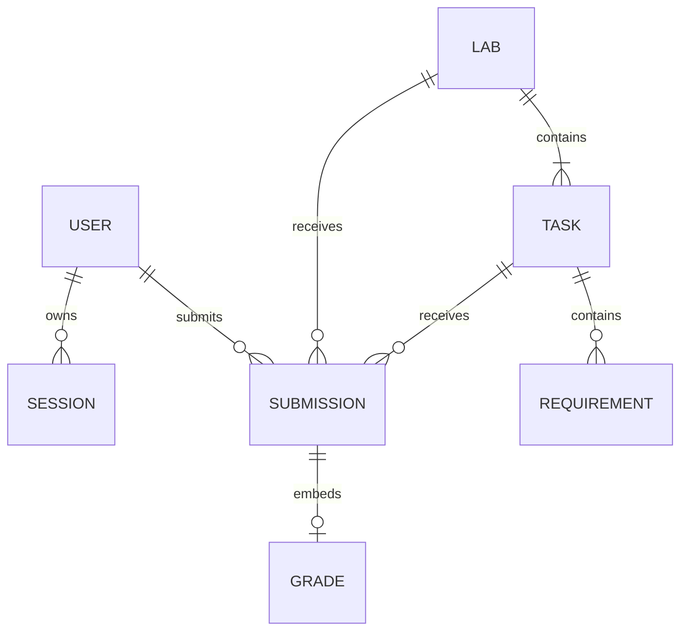
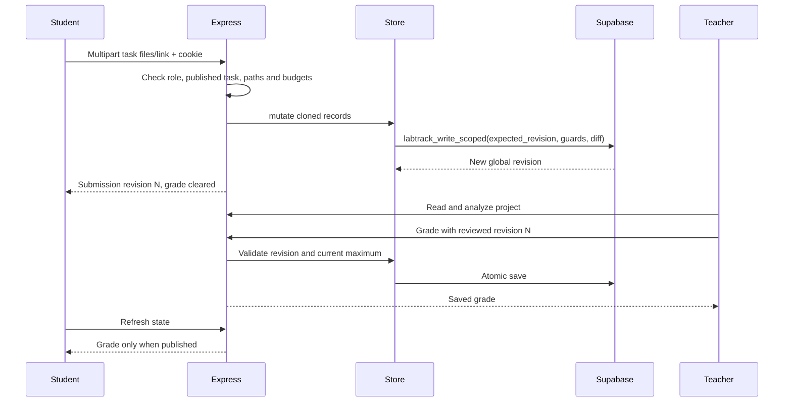

# Architecture and data flow

LabTrack separates React (`src/`), Express/domain services (`server/`) and public contracts (`shared/`). Supabase is private server persistence. There is no ORM or Supabase JavaScript SDK; `server/supabase.ts` uses Node `fetch` against REST RPC endpoints.

The public showcase shares the website and Supabase project with the classroom, but uses an independent `labtrack_demo_*` persistence namespace. Requests authenticate against one store; teachers, students, projects, sessions and revision counters never cross stores. See [public demo](public-demo.md) for routing, fixed credentials and limits.

## Runtime modes

| Mode | Lifecycle |
| --- | --- |
| Development | Vite on 5173 proxies to Node on 3001. Node loads `.env`, opens one store and holds it until restart. |
| Built persistent server | Same Node entrypoint serves `dist/` and API. Supports any one adapter. |
| Vercel | Static frontend; `/api/*` reaches `api/index.ts`. Requires Supabase and creates/closes an app/store per non-fast-path request. |

The Vercel handler checks database configuration first. Health, unsigned state and unsigned protected requests then avoid database reads. A correctly shaped cookie triggers a database-backed request; shape alone never authenticates the user. Express validates the current session against the loaded records.

Serverless reads check the global revision each time. An unchanged revision reuses a cloned private snapshot capped at 16 MiB; a changed revision reloads records. Failed connections do not use stale cache. Persistent Supabase refreshes the revision before protected requests and login. JSON/MongoDB keep a process snapshot; external changes there still require a restart.

Persistent startup retries only the initial Supabase read on transient failures: at most three attempts within 45 seconds, each request limited to 15 seconds. It does not retry app bootstrap writes, later conflict reloads or serverless reads. Configuration/migration/data errors fail immediately; an exhausted startup needs a manual or supervised restart. See [local Supabase recovery](supabase-local.md#development-behavior).

## Repository map

| Path | Responsibility |
| --- | --- |
| `src/main.tsx`, `src/WorkspaceBoundary.tsx` | React root, fonts, stylesheet order and page-loading recovery |
| `src/App.tsx` | State, login, portals, dialogs and common mutations |
| `src/TeacherPortal.tsx`, `src/StudentPortal.tsx` | Teacher dashboard/navigation and student pages |
| `src/LabEditor.tsx`, `src/Review.tsx` | Lab/task editing and individual grading |
| `src/CheckTasks.tsx`, `src/TaskComparison.tsx` | Task queue, flags, pair comparison and grades |
| `src/preview.ts`, `src/submission-assets.ts` | HTML isolation and protected images |
| `src/student-progress.ts` | Progress calculations |
| `src/BrandLogo.tsx`, `src/*.css` | Brand and base/portal/finishing styles |
| `src/api.ts` | Same-origin request helper and generated downloads |
| `server/index.ts` | Environment loading, listener and shutdown |
| `server/app.ts` | Routes, roles, validation and bootstrap |
| `server/auth.ts` | Password hashes and session tokens |
| `server/store.ts` | Database types, mutation queue and adapters |
| `server/supabase.ts` | REST RPCs, diffs, revisions, cache and limiter |
| `server/uploads.ts` | Safe paths, ZIPs, encoding and budgets |
| `server/analysis.ts` | Requirements, quality and similarity |
| `server/instructions.ts` | Instruction text and candidate rules |
| `server/marks-sheet.ts`, `server/marks-sheet-xlsx.ts` | Totals, CSV, marks words, print HTML and styled Excel export |
| `server/seed.ts`, `server/fixtures/` | Demo data and original documents |
| `server/class-setup.ts`, `server/analysis-demo.ts` | Explicit provisioning and isolated analysis demo |
| `shared/types.ts`, `shared/roster.ts` | Public contract, roll bounds, ordering/migration |
| `api/index.ts` | Vercel handler and early responses |
| `supabase/migrations/` | Schema, RPC and limiter history |
| `vite.config.ts`, `tsconfig.json` | Dev proxy/build and strict typing |
| `vercel.mjs`, `render.yaml` | Active Vercel configuration and optional Render template |
| `server/*.test.ts`, `src/*.test.ts` | Tests via Node runner and `tsx` |

## Logical data model

These are logical relationships, not separate SQL tables or foreign keys. Tasks/requirements are inside labs; grades are inside submissions. Supabase stores five collections as JSONB metadata documents, with submission source and binary bytes in a separate private payload table.

Public `User` excludes `passwordHash`; public `Submission` excludes binary base64. Server `Database` contains these private fields and sessions. Authorized state includes file paths with empty content and sourceOmitted=true, plus instruction base64. Selected source and images use authenticated, revision-checked reads. Teachers see all students/labs/submissions/activity. Students see themselves, published labs and their own work, with draft grades removed.

Student first-login setup is an exception: `mustChangePassword=true` permits only minimal own-user state, password creation and sign-out/login. No classroom state or routes are accessible until setup completes. Private user/session credential versions revoke older sessions; setup cookies use a distinct prefix and a 15-minute lifetime. See [student logins](student-logins.md).

## Invariants

- User IDs remain stable. Student emails/rolls are unique; rolls are canonical strings 1–41.
- Preserve lab/task IDs. Tasks with submissions cannot be removed. Maximum marks cannot fall below recorded grades. Backend computes `totalMarks`.
- One current submission exists per student/lab/task through application mutations. Resubmission retains its ID, increments revision, replaces work/timestamp and removes its grade. Old revisions are not archived.
- Grades are finite numbers from zero to the current task maximum. Saving requires the current integer submission revision. Draft grades count in teacher exports and stay hidden from students.
- `dueDate` is ISO or `""`. Late submissions are accepted and marked. UI deadlines use Pakistan time.
- Analysis never assigns marks, penalties or AI authorship labels.
- All writes go through `Store.mutate`. Global database revision and submission revision protect different things; retain both.
- JSONB constraints do not enforce every domain relationship. Manual SQL can bypass application validation and create invalid records.

## Submission and grading flow

Scoped SQL compares touched records plus user/lab authorization dependencies, permitting independent writes despite a changed global revision. Persistent conflicts reload then return 409 after one attempt. Serverless conflicts reload and rerun validation for up to eight attempts with increasing jitter and a shared 45-second budget. Never replay a stale snapshot or introduce an unbounded retry.

Lost write acknowledgements trigger a bounded read-only reconciliation, never an automatic transport replay. A confirmed write followed by a failed reload remains acknowledged, and subsequent access must reload successfully. The frontend acknowledges saves separately from state refresh failures. There is no background polling, realtime socket, client router or global state library. See [frontend](frontend.md) and [backend](backend.md).
