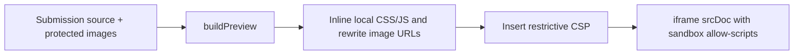

# Frontend guide

The frontend is a React 19 TypeScript SPA built by Vite 7 with Tailwind CSS 4 and custom CSS. The repository has no React Router, Redux or browser Supabase client. API state is owned by `App`; portal navigation is component state.

## Component responsibilities

| File | Behavior |
| --- | --- |
| [main.tsx](../src/main.tsx) | Mounts `App` in StrictMode and a recovery boundary; imports fonts and global styles |
| [WorkspaceBoundary.tsx](../src/WorkspaceBoundary.tsx) | Reload action on render or deferred-module loading failure |
| [App.tsx](../src/App.tsx) | Loads `/state`, shows loading/retry or login, chooses role portal, owns editor/review/upload/student dialogs, refreshes after changes |
| [TeacherPortal.tsx](../src/TeacherPortal.tsx) | Dashboard, Check tasks, Labs, Students; roll-sorted roster; published/draft filters; review queue; marks-sheet links |
| [StudentPortal.tsx](../src/StudentPortal.tsx) | Published labs, per-task submission status, published feedback, instructions download, submission history and sign-out |
| [LabEditor.tsx](../src/LabEditor.tsx) | Clones a lab into a local draft; edits one task at a time, rules, marks, deadline and publication; preserves existing task IDs |
| [Review.tsx](../src/Review.tsx) | Individual source/preview/analysis; image downloads; grade form; students view their own work without teacher grading actions |
| [CheckTasks.tsx](../src/CheckTasks.tsx) | Fetches selected lab/task analysis; missing/pending/similar filters; flags both members of every comparable pair over threshold |
| [TaskComparison.tsx](../src/TaskComparison.tsx) | Complete projects side by side; targeted evidence; independent preview/source and grading forms |
| [preview.ts](../src/preview.ts) | Resolves local paths, transforms uploaded HTML and inserts restrictive CSP |
| [submission-assets.ts](../src/submission-assets.ts) | Protected raster downloads for comparison; data URLs; cancellation/error state keyed by submission ID/revision |
| [student-progress.ts](../src/student-progress.ts) | Task submission counts and published-grade totals only |
| [BrandLogo.tsx](../src/BrandLogo.tsx) | Shared branding |
| [api.ts](../src/api.ts) | Typed request helper and Blob downloads |

`Review` and comparison use the shared asset hook with cancellation and visible failures. The instruction-analysis endpoint exists, but the current `LabEditor` does not invoke it or provide a new attachment picker. Existing attachments survive the cloned lab/save flow.

Teacher/student portals load through `React.lazy` only when their role is rendered. Suspense uses the existing loading style; the root boundary offers reload if a module cannot load. Login does not download either portal. The unused chart and Recharts dependency were removed.

The login screen alone shows a **Need help logging in?** WhatsApp link below the form. It opens a new tab to chat with +49 163 0278010, with a login-help message prefilled for the user to send.

The button uses the unmodified white digital glyph from [Meta’s official WhatsApp logo pack](https://www.meta.com/brand/resources/whatsapp/whatsapp-brand/), stored locally as `public/whatsapp-logo-white.svg` (archive file `Digital_Glyph_White_RGB_2026.svg`).

Teachers can open **Students**, select a roll number, enter the student's **Full name** in the profile, and choose **Save name**. Only the name changes; login details, roll numbers and saved work stay intact. Conflicting name edits return a visible error and require a refresh.

When the signed-in user has `mustChangePassword=true`, `PasswordSetup.tsx` replaces the workspace with a focused personal-password form. Students enter a password of at least six characters twice; mismatches stay on the form. Both entries are visible by default with a Hide/Show passwords toggle. Successful saves update the user before refreshing state, so a failed refresh does not prompt another password change. Server gates enforce the restriction independently of the UI. See [student logins](student-logins.md).

Dashboard submission blocks show the student's name, roll number and status immediately on hover, keyboard focus or touch. Escape or tapping elsewhere dismisses the tooltip; names come from the authorized roster, with no extra request. Tooltips stay within the progress row at either edge.

## State and requests

Lab 3's named semantic checks are editable through the **Lab 3 requirement** check type and a list of supported requirements. Code analysis shows the explanation directly below each failed/review check. **Not met** identifies incorrect or missing evidence; **Needs review** identifies evidence static analysis cannot establish reliably. Both remain outside the passed count. See [Lab 3 checker](lab3-checker.md).

The teacher's submission review fills the viewport, giving the preview and source most of the space. Desktop uses a compact 290px grading sidebar. Mobile stacks the supporting panels below the large preview. Preview and source share a compact tab row; a preview entrypoint selector appears there only for multiple HTML pages. Duplicate filename/browser bars are omitted, and source downloads sit in the tab row beside the source file list. The sidebar displays actual requirement/quality/similarity results and never assigns a grade. Clicking the similarity score or alert opens Code comparison with the highest comparable peer's matching evidence selected and scrolls/focuses that section.

Teachers can switch between the current student's tasks inside review; buttons show marks (including draft grades), Pending, or Missing. Missing work cannot be opened or automatically graded. Switching tasks/students or closing with unsaved marks, feedback or publication changes offers Keep editing or Discard; page exit uses the browser's unsaved-change warning. Navigation is blocked while saving. The selected Pending/All queue filter survives review navigation. Save & Next (also Ctrl/Cmd+Enter) stays in numeric roll order within the task; Pending wraps to earlier ungraded submissions first. At the end of a task, Save & Begin Task N opens the next task with pending work, skipping empty/fully graded tasks and wrapping through the lab's task order before declaring completion. A cross-task transition selects Pending mode. A saved grade followed by a failed state refresh stays on the current review and reports the refresh failure.

Opening a teacher review, changing the student/task or loading a new submission revision focuses the marks input and selects any saved number. Teachers can type a replacement and use Ctrl/Cmd+Enter to save and advance; focus returns to the next submission's marks input. Unsaved-change confirmation retains its own focus behavior.

Check tasks uses one-click task buttons with pending counts from authorized state, independent of the selected analysis/filter. Counts update after state refresh; they do not include missing work. `review-queue.ts` owns review ordering and next-task selection, covered by `review-queue.test.ts`.

Review next ungraded in the progress panel opens the selected lab/task's first ungraded submission in numeric roll order, independent of table searches, filters, sorting and analysis availability. Saved draft/zero grades and missing work are skipped. With no pending submissions, the button reads No ungraded submissions and is disabled. Closing a review and reopening this action resumes at the first remaining submission after saved grades refresh state.

The teacher shell uses a compact 64px header and 24px content inset. Check tasks has a smaller page heading, 12px gaps between controls and a compact progress panel so the student list appears sooner; the toolbar, task buttons and filters retain at least 44px height. The sidebar also groups navigation more closely on wide screens. On phones, task buttons use three columns and the threshold selector shares a row with Refresh.

1. `App.refresh()` calls `api<AppState>("/state")`.
2. If an unsigned development state says `demo=true`, startup requests the teacher demo then reloads state. Real environments show login.
3. The signed-in user's role selects the portal. Role-based UI is presentation; server checks remain authoritative.
4. Mutations call the API and reload state. Dialog state/toasts stay in React; records are persisted by the backend.
5. Manual refresh obtains external changes; there is no automatic polling or realtime update.

`api()` prepends `/api`, sends same-origin cookies and JSON headers unless the body is `FormData`. Errors are `Error` objects with a numeric `status`. Only GETs with an empty/non-JSON 500/502/503 gateway response retry, up to three additional attempts one second apart. JSON API errors, writes and fetch exceptions are not automatically retried. Reads have a 20-second deadline and writes 50 seconds, covering response bodies; caller abort signals cancel work. Failed writes report an uncertain outcome instead of inviting blind replay.

Do not set multipart `Content-Type` manually: the browser must generate its boundary. Folder upload filenames include relative paths. State contains source paths and empty content, with `sourceOmitted=true`. `submission-source.ts` loads only the selected revision's text, while `submission-assets.ts` progressively loads images with at most four requests per project. Do not persist source or state in browser storage/logs.

Analysis/evidence are attached to task-description/requirements and submission-ID/revision fingerprints, with cancellation on replacement. Stale results are immediately hidden. Grade forms send the displayed revision, disable edits while saving and refresh on HTTP 409. Successful mutations are acknowledged before refreshing state; a failed refresh explicitly reports that the save succeeded. New-lab operation keys survive uncertain responses. Full lab drafts, uploads and grades include their displayed revision/timestamp guards. Comparison tracks both panes' drafts and active saves, guarding navigation, refresh, logout and page unload.

## Styling and accessibility

Styles load in this order: `styles.css` → `teacher.css` → `student.css` → `polish.css` → `review.css`. Later rules can override earlier ones. `review.css` scopes the teacher submission dialog's preview workspace and task/analysis/grading panels; mobile stacks the panels below the preview. Check all relevant sheets before adding selectors; avoid broad rules that affect both portals unintentionally. Phosphor provides interface icons; fonts are installed locally through Fontsource.

The workspace uses a Quordix-inspired white-and-orange palette: white surfaces, slate text, orange actions and soft orange selected states. Shared `--workspace-*` tokens in `polish.css` feed the teacher/student palettes; darker orange is used for small accent text, while bright orange buttons use dark ink for contrast. The login brand panel includes a subtle dotted background. Keep the existing component styling and responsive rules when extending it. There is no separate UI-component package or generated design-token file.

Sign-in and first-password screens show a small Quordix credit at every screen size. At phone widths below 768px, login uses a compact brand panel so the sign-in form appears sooner. The student workspace has a compact horizontal header with its two existing navigation items on desktop, and a floating bottom navigation below 768px. Its centered content is limited to 1240px, with a course progress summary, numbered lab rows, neutral unsubmitted tasks, orange submitted tasks and green published results. Lab filters, task accordions, marks and feedback retain their existing behavior. The footer carries the Quordix credit on all screen sizes. Student task actions retain 44px minimum touch targets, and the submission dialog keeps its actions visible while its body scrolls. These styles are scoped to the student portal; the shared login and teacher workspace retain their existing layout.

Shared dialogs make background regions inert, lock body scroll, manage focus and trap Tab. `LabEditor` owns its focus/scroll lifecycle. Portal page changes move focus to their content region; status/errors use accessible roles. Preserve labels, keyboard controls, focus restoration and mobile sign-out when editing layouts. `Ctrl/Cmd+K` focuses search; Escape closes common dialogs.

User-facing dates use `en-GB` formatting in `Asia/Karachi`. `LabEditor` interprets deadline inputs using `+05:00` and the backend stores ISO timestamps. Keep empty deadlines as `""`; do not turn them into an invalid date or implicit deadline.

## Marks-sheet downloads

Teachers can download a formatted Excel marks sheet from the lab library or class register; CSV and the printable marks sheet remain available beside it. Excel preserves column widths, wrapping, orange headings and frozen headers. CSV contains only values and cannot retain spreadsheet formatting.

Print marks sheet opens a lab picker with the current lab checked. Select one lab for roll number, name, each task's saved marks and the lab total. Select multiple labs for roll number, name, each selected lab's total and an overall total; task columns are omitted. Preview opens before Print / Save PDF, and Choose labs returns to the picker with the selection preserved. Reports include saved draft grades and zero marks; a total stays blank until all its tasks/labs are graded. Printing includes the full roster regardless of the class register's search/filter. Larger reports use A4 landscape and a horizontally scrollable preview on phones. CSV and Excel retain their existing single-lab format.

## Submitted-code preview

The iframe has `sandbox="allow-scripts"` without `allow-same-origin`. CSP blocks network connections, remote scripts/styles/images, nested frames, objects, forms and base URLs. Local scripts/CSS are inlined; raster bytes become data URLs. Submitted code never executes in the teacher application's origin.

Links send a `labtrack:navigate` message to the parent. Both review views check the sending iframe's `contentWindow`, resolve the path and only select an uploaded HTML file; anchors scroll within the frame. Do not relax the sandbox/CSP or turn messages into arbitrary URLs/HTML. External libraries, ES-module dependency resolution and server-side apps are outside this preview's supported scope.

Upload validation and preview path resolution are different: the upload parser rejects traversal, while the preview resolver allows legitimate relative navigation within the already accepted project.

## Change recipes

| Change | Places to inspect |
| --- | --- |
| Add a lab/task field | `shared/types.ts`, `LabEditor`, `App.saveLab`, backend `validateLab`, seed data and API docs |
| Add student-visible grading data | Public types, backend sanitization, both grading forms, `StudentPortal`, progress/export rules |
| Change previews | `preview.ts`, `Review`, `TaskComparison`, asset hook and preview tests |
| Change roll limits/order | `shared/roster.ts`, backend student route, seed/provisioning, both portals and report tests |
| Change task flags | Analysis contract/backend and `CheckTasks`; retain human grading |

Run `npm run build` for strict typing and bundling. Relevant unit tests are `src/api.test.ts`, `src/preview.test.ts`, `src/student-progress.test.ts` plus backend tests for changed contracts. These tests do not replace a real browser check of desktop/mobile, dialogs and sandbox behavior. See [operations](operations.md).
