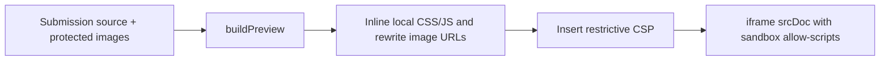

# Frontend guide

The frontend is a React 19 TypeScript SPA built by Vite 7 with Tailwind CSS 4 and custom CSS. The repository has no React Router, Redux or browser Supabase client. API state is owned by `App`; portal navigation is component state.

## Component responsibilities

| File | Behavior |
| --- | --- |
| [main.tsx](../src/main.tsx) | Mounts `App` in StrictMode and a recovery boundary; imports fonts and global styles |
| [WorkspaceBoundary.tsx](../src/WorkspaceBoundary.tsx) | Reload action on render or deferred-module loading failure |
| [App.tsx](../src/App.tsx) | Loads `/state`, shows loading/retry or login, chooses role portal, owns editor/review/upload/student dialogs, refreshes after changes |
| [TeacherPortal.tsx](../src/TeacherPortal.tsx) | Dashboard, Check tasks, Labs, Students; roll-sorted roster; published/draft filters; review queue; marks-sheet links |
| [StudentPortal.tsx](../src/StudentPortal.tsx) | Published labs, per-task submission status, published feedback, instructions download, submission history and sign-out |
| [LabEditor.tsx](../src/LabEditor.tsx) | Clones a lab into a local draft; edits one task at a time, rules, marks, deadline and publication; preserves existing task IDs |
| [Review.tsx](../src/Review.tsx) | Individual source/preview/analysis; image downloads; grade form; students view their own work without teacher grading actions |
| [CheckTasks.tsx](../src/CheckTasks.tsx) | Fetches selected lab/task analysis; missing/pending/similar filters; flags both members of every comparable pair over threshold |
| [TaskComparison.tsx](../src/TaskComparison.tsx) | Complete projects side by side; targeted evidence; independent preview/source and grading forms |
| [preview.ts](../src/preview.ts) | Resolves local paths, transforms uploaded HTML and inserts restrictive CSP |
| [submission-assets.ts](../src/submission-assets.ts) | Protected raster downloads for comparison; data URLs; cancellation/error state keyed by submission ID/revision |
| [student-progress.ts](../src/student-progress.ts) | Task submission counts and published-grade totals only |
| [BrandLogo.tsx](../src/BrandLogo.tsx) | Shared branding |
| [api.ts](../src/api.ts) | Typed request helper and Blob downloads |

`Review` and comparison use the shared asset hook with cancellation and visible failures. The instruction-analysis endpoint exists, but the current `LabEditor` does not invoke it or provide a new attachment picker. Existing attachments survive the cloned lab/save flow.

Teacher/student portals load through `React.lazy` only when their role is rendered. Suspense uses the existing loading style; the root boundary offers reload if a module cannot load. Login does not download either portal. The unused chart and Recharts dependency were removed.

## State and requests

1. `App.refresh()` calls `api<AppState>("/state")`.
2. If an unsigned development state says `demo=true`, startup requests the teacher demo then reloads state. Real environments show login.
3. The signed-in user's role selects the portal. Role-based UI is presentation; server checks remain authoritative.
4. Mutations call the API and reload state. Dialog state/toasts stay in React; records are persisted by the backend.
5. Manual refresh obtains external changes; there is no automatic polling or realtime update.

`api()` prepends `/api`, sends same-origin cookies and JSON headers unless the body is `FormData`. Errors are `Error` objects with a numeric `status`. Only GETs with an empty/non-JSON 500/502/503 gateway response retry, up to three additional attempts one second apart. JSON API errors, writes and fetch exceptions are not automatically retried.

Do not set multipart `Content-Type` manually: the browser must generate its boundary. Folder upload filenames include relative paths. Full state contains authorized source text, so avoid copying it into extra persistent browser storage or logs.

Analysis/evidence are attached to task-description/requirements and submission-ID/revision fingerprints, with cancellation on replacement. Stale results are immediately hidden. Grade forms send the displayed revision, disable edits while saving and refresh on HTTP 409. A successful save followed by failed refresh explicitly reports that the grade was saved.

## Styling and accessibility

Styles load in this order: `styles.css` → `teacher.css` → `student.css` → `polish.css`. Later rules can override earlier ones. Check all relevant sheets before adding selectors; avoid broad rules that affect both portals unintentionally. Phosphor provides interface icons; fonts are installed locally through Fontsource.

The teacher portal uses warm paper surfaces, graphite navigation and orange actions. Keep the existing component styling and responsive rules when extending it. There is no separate UI-component package or generated design-token file.

Shared dialogs make background regions inert, lock body scroll, manage focus and trap Tab. `LabEditor` owns its focus/scroll lifecycle. Portal page changes move focus to their content region; status/errors use accessible roles. Preserve labels, keyboard controls, focus restoration and mobile sign-out when editing layouts. `Ctrl/Cmd+K` focuses search; Escape closes common dialogs.

User-facing dates use `en-GB` formatting in `Asia/Karachi`. `LabEditor` interprets deadline inputs using `+05:00` and the backend stores ISO timestamps. Keep empty deadlines as `""`; do not turn them into an invalid date or implicit deadline.

## Submitted-code preview

The iframe has `sandbox="allow-scripts"` without `allow-same-origin`. CSP blocks network connections, remote scripts/styles/images, nested frames, objects, forms and base URLs. Local scripts/CSS are inlined; raster bytes become data URLs. Submitted code never executes in the teacher application's origin.

Links send a `labtrack:navigate` message to the parent. Both review views check the sending iframe's `contentWindow`, resolve the path and only select an uploaded HTML file; anchors scroll within the frame. Do not relax the sandbox/CSP or turn messages into arbitrary URLs/HTML. External libraries, ES-module dependency resolution and server-side apps are outside this preview's supported scope.

Upload validation and preview path resolution are different: the upload parser rejects traversal, while the preview resolver allows legitimate relative navigation within the already accepted project.

## Change recipes

| Change | Places to inspect |
| --- | --- |
| Add a lab/task field | `shared/types.ts`, `LabEditor`, `App.saveLab`, backend `validateLab`, seed data and API docs |
| Add student-visible grading data | Public types, backend sanitization, both grading forms, `StudentPortal`, progress/export rules |
| Change previews | `preview.ts`, `Review`, `TaskComparison`, asset hook and preview tests |
| Change roll limits/order | `shared/roster.ts`, backend student route, seed/provisioning, both portals and report tests |
| Change task flags | Analysis contract/backend and `CheckTasks`; retain human grading |

Run `npm run build` for strict typing and bundling. Relevant unit tests are `src/api.test.ts`, `src/preview.test.ts`, `src/student-progress.test.ts` plus backend tests for changed contracts. These tests do not replace a real browser check of desktop/mobile, dialogs and sandbox behavior. See [operations](operations.md).
